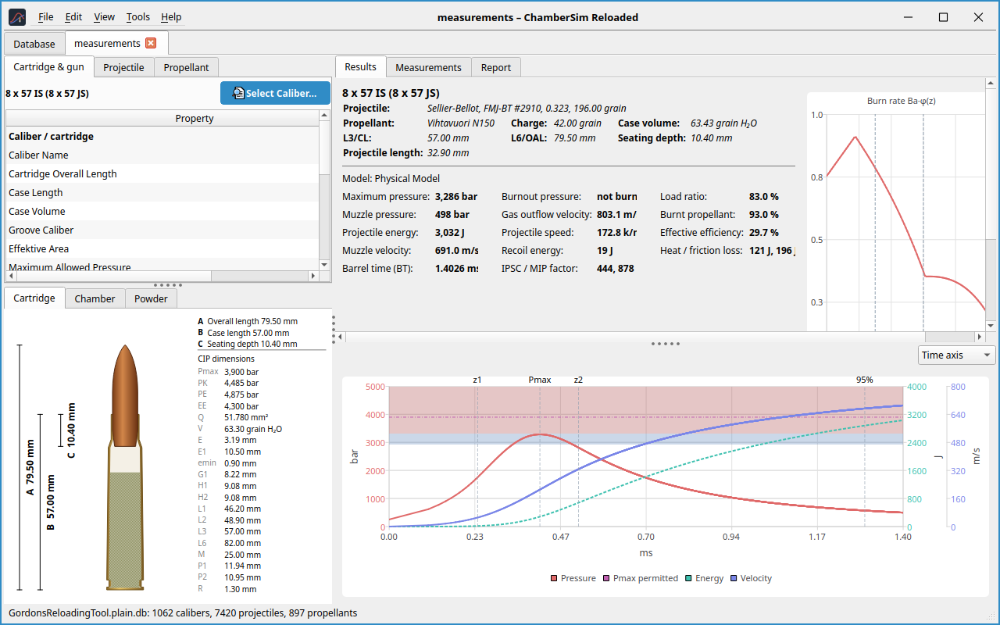
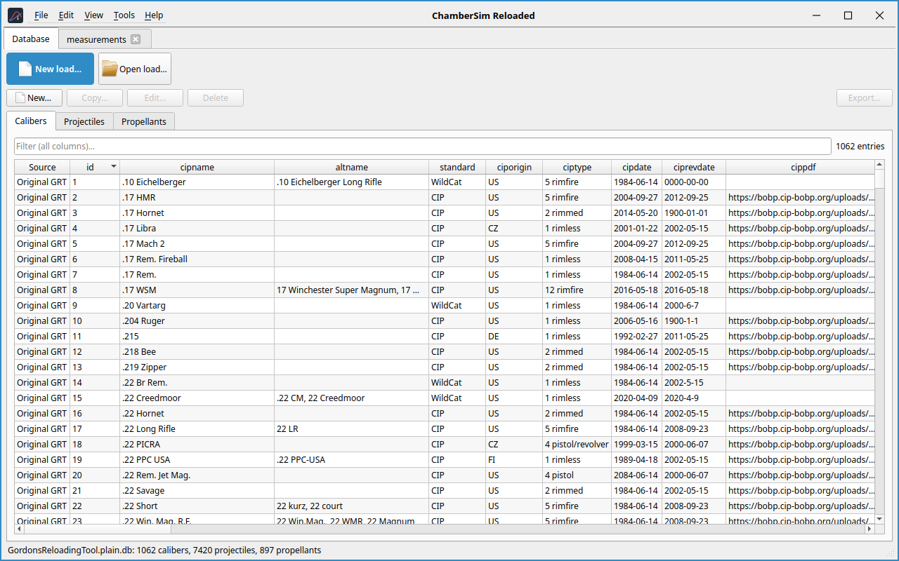
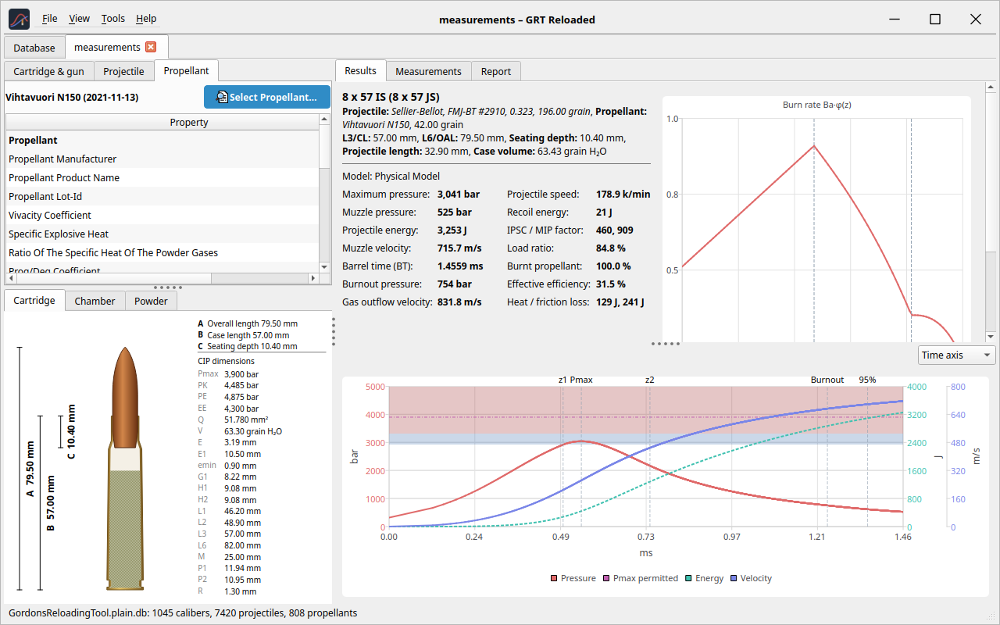
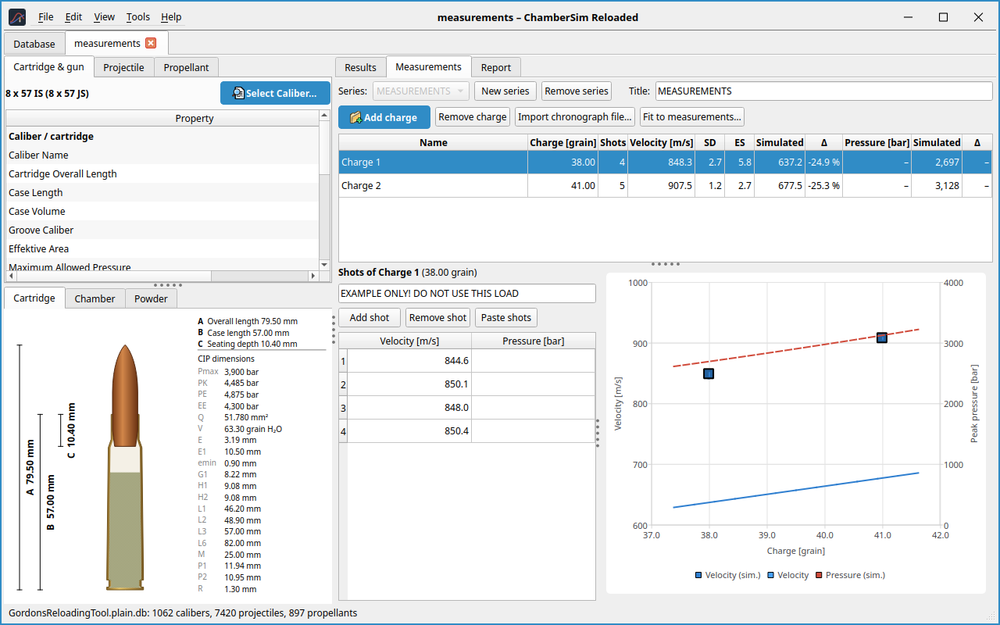
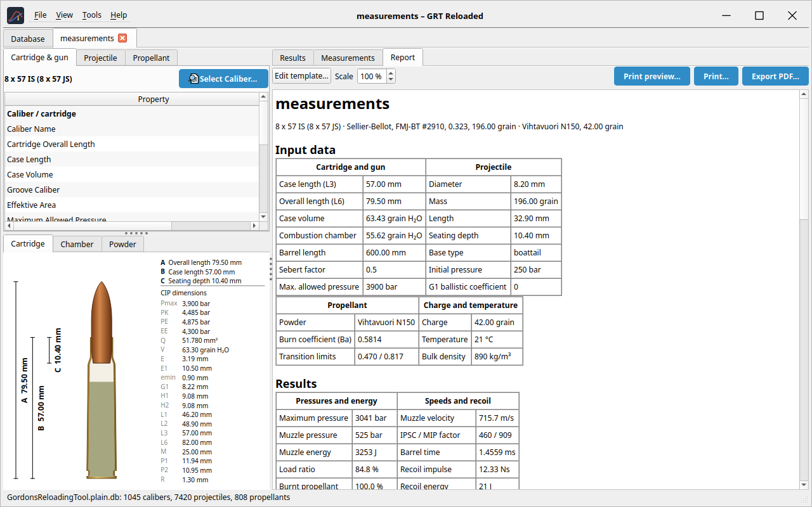

> [!WARNING]
> The results of this program are *calculated*. They can differ
> considerably from reality. Compare every load with the current loading
> tables of the component manufacturers and start low. The software is
> provided “as is”, without warranty of any kind. The author and all
> contributors accept no responsibility or liability for any damage,
> injury or death or any other consequence of using this software or its
> results, including damage to firearms or property. Reloading ammunition
> is dangerous and is done entirely at your own responsibility.

*ChamberSim Reloaded is an independent project. It is not affiliated
with, endorsed or supported by Gordon’s Reloading Tool or its author.*

# Introduction

ChamberSim Reloaded calculates the *interior ballistics* of a handload:
you choose a cartridge, a bullet and a powder, enter the powder charge,
and the program simulates how the pressure, the bullet velocity and the
bullet energy develop while the bullet travels through the barrel. From
that it reports the maximum pressure, the muzzle velocity, the barrel
time and many related values. A load development ladder, charts, reports
and printouts help to plan a series of test loads.

It follows the workflow of *Gordon’s Reloading Tool* (GRT). It can open
the original’s `.grtload` files and can use the original’s database, but
stores its own loads in the `.csrload` format.

## What the program can do

- Cartridge, projectile and propellant records from a database; replace
  any component of a load; add your own records.

- Pressure, energy and velocity curves with markers and pressure bands,
  a burn-rate chart and a load ladder.

- Drawings of the cartridge and the chamber with the C.I.P. dimensions.

- A Measurements tab for chronograph and pressure data, with statistics
  (mean, SD, ES) and a comparison with the simulation.

- Fit to measurements: adapts the model values of a powder to your own
  data.

- Reports with a template editor, print preview and PDF export.

- Metric, imperial and original units (also per field), light and dark
  themes, adjustable font size.

- Translations: English, German, French and Italian.

## How accurate is it?

The default *Physical Model* is fitted to published load data of powder
manufacturers. Against loads that were left out of the fit, the muzzle
velocity is typically within 3–6 % (root mean square; Vihtavuori powders
about 3 %, Hodgdon about 6 %) and the peak pressure within about 15 %
where the tables publish it. The scatter of the published tables
themselves (lots, barrels, components) is of that size. Single loads can
deviate much more. Unusual loads, other powders and other cartridges
than the ones tested can deviate more again; slow powders at low
pressure, pistol and revolver cartridges (about 8 % in velocity and 19 %
in pressure) and shotgun loads (about 3 % in velocity and 16 % in
pressure, with their own constants) are known weak spots. The velocity
gain with the barrel length is slightly too steep: against published
cut-down series the model loses about 1 % more velocity at 16 than at 24
inches than was measured. Powders
without physical burn values, such as your own records, are less
accurate than the project’s powders. The GRT Original model reproduces
the results of the original program to about 1 % in velocity and 3 % in
pressure. The files `README.md` and `docs/ACCURACY.md` of the project
contain the current accuracy tables.

> [!WARNING]
> Never use a calculated load without checking it against the
> manufacturer’s data. Work up from a safe starting charge and watch for
> signs of excessive pressure.

# Installation and first start

## Installing

Release builds are available from the project’s GitHub page: an AppImage
for Linux and a zip file for Windows. Unpack or make the AppImage
executable and start it; no installation is needed. Both contain this
manual (**Help** → User manual, F1); the Windows zip also contains the
Visual C++ runtime, so nothing else has to be installed. To build the
program yourself you need Qt 6.4 or newer, CMake 3.16 or newer and a
C++20 compiler:

    tools/build.sh release
    build/release/ChamberSimReloaded

## Safety notice

At every start a safety notice is shown. Read it, then choose I
understand; Quit closes the program. With Do not show this again ticked,
I understand also switches the notice off for later starts. There is no
entry in the settings to bring it back.

## Command-line options

    ChamberSimReloaded [options] [load.csrload ...]
      -d, --database <file> the original's (plain) database
      -r, --reference <f>   overlay a reference result (JSON) on the chart
      --calibration <m>     solver model: original|published|physical
      --language <code>     de_DE, en_US, fr_FR, it_IT
      --theme <t>           light | dark
      --units <system>      metric | imperial | original
      --log-level <level>   debug | info | warning | error
      --help                all options

Files given on the command line are opened as loads. `--theme` applies
to this run only; `--units` and `--calibration` are saved like the
choices in the settings. `--screenshot` saves an image of the window and
exits (for documentation; see `--help` for `--tab`, `--input-tab` and
`--result-tab`).

## Simulating without the window

The program `csr_sim` runs simulations without a graphical interface,
for scripts and batch jobs. It reads `.csrload` and `.grtload` files and
prints one row per load and ladder step.

    csr_sim [options] load.csrload|load.grtload ...
      --profile <m>         original | published | physical (default)
      --grt-original        use the Original model for .grtload files
      --charge <g>          override the charge of the load
      --ladder-count <n>    override the number of ladder steps
      --ladder-step <g>     override the charge difference of the ladder
      --format <f>          table (default) | csv | json
      --out <file>          write the results to a file
      --curve <file.csv>    pressure/velocity curve of the focused ladder step;
                            {name} is replaced by the load's file name
      --steps <n>           position steps of the solver (default 2000)

The program’s project data (physical burn values of the powders and the
factors of the pistol and revolver calibers) are built in, so the
results equal those of the program. Each row holds the charge, maximum
and muzzle pressure, muzzle velocity, energy and time, burnt fraction,
efficiency, burnout in the barrel, load ratio and the status. Units are
g, mm, bar, m/s, J and ms, whatever the unit settings of the program.
The exit code is 0 when all simulations succeeded, 1 when at least one
failed (for example because the charge does not fit into the case) and 2
for a usage or file error.

# The main window

The window has a menu bar and, below it, a row of tabs. The first tab,
Database, is always present; every open load gets a tab of its own. On
Linux the program draws its own title bar with the menu in the title row
(**File** → Settings → Appearance).

<figure id="fig:main" data-latex-placement="ht">

<figcaption>A load. Left: the input tabs (top) and the drawings
(bottom). Right: results, measurements and report.</figcaption>
</figure>

## Menus

New load… (Ctrl+N), Open load… (Ctrl+O), Open recent, Save (Ctrl+S),
Save as…, Print preview…, Print… (Ctrl+P), Export report as PDF…,
Overlay reference result… (Ctrl+R), Clear reference overlay, Settings…
(Ctrl+,) and Quit.

Undo (Ctrl+Z) and Redo (Ctrl+Shift+Z or Ctrl+Y) for the load that is
shown; see Section <a href="#sec:undo" data-reference-type="ref"
data-reference="sec:undo">5.6</a>.

Theme (system default, light, dark) and Language. A language change
takes effect after a restart.

Burn rate table… and Unit converter….

User manual (F1), which opens this manual as a PDF, and About ChamberSim
Reloaded…

## Layout

The panels are separated by splitters (the small dotted handles) that
you can drag. The program remembers the splitter positions, the column
widths of the property tables and the window geometry.

# The database

The Database tab
(Figure <a href="#fig:database" data-reference-type="ref"
data-reference="fig:database">2</a>) lists the Calibers, Projectiles and
Propellants that are available for loads. The filter field searches all
columns; click a column header to sort.

<figure id="fig:database" data-latex-placement="ht">

<figcaption>The Database tab.</figcaption>
</figure>

## Where the records come from

The list is one view made of up to three sources, shown in the Source
column:

1.  The **project database**: calibers, projectiles and propellants that
    are built into the program.

2.  Your **own records**, stored in the file `ChamberSimReloaded.db` in
    the application data folder. Everything you create or copy is stored
    here.

3.  Optionally the records of **Gordon’s Reloading Tool** (Original
    GRT). The original’s database is encrypted and must first be
    converted to a plain copy
    (Section <a href="#sec:dump" data-reference-type="ref"
    data-reference="sec:dump">4.2</a>); choose that copy in
    **File** → Settings → Database. It is only read, never changed.

## Using the original’s database

Gordon’s Reloading Tool keeps its calibers, projectiles and propellants
in an encrypted SQLite database (`GordonsReloadingTool.db`). ChamberSim
Reloaded does not decrypt it by itself and does not ship one. A helper
script makes a *plain* (unencrypted) *copy* that you then choose in the
settings. The program and its database stay unchanged; only the copy is
converted. You need your own installation of Gordon’s Reloading Tool.

### How it works.

The script starts a scratch copy of the original program. As soon as the
original has unlocked its database, the script asks it to remove the
encryption from that copy. Nothing is compiled and no key is typed in.

### Linux.

1.  Unpack the *Linux* version of Gordon’s Reloading Tool. Its folder
    contains `GordonsReloadingTool`, `libs/` and
    `GordonsReloadingTool.db`.

2.  Copy `tools/grt_decrypt_db.sh` from the ChamberSim Reloaded sources
    into that folder.

3.  Open a terminal in that folder and run

        ./grt_decrypt_db.sh

4.  The script checks what is needed and, after asking, installs what is
    missing with `sudo`: the debugger `gdb`, the 32-bit GTK 2 runtime
    that the original needs and, when no desktop is running, a virtual
    display. Debian/Ubuntu/Mint, Fedora, Arch/Manjaro and openSUSE are
    supported.

5.  After a few seconds the file `GordonsReloadingTool.plain.db` appears
    in the same folder.

Options: `-o FILE` (name of the output file), `-y` (install without
asking), `-c` (only report what is found and missing, change nothing),
`--headless` (use a virtual display, no window appears), `-t SECONDS`
(give up after this time, default 90) and `-h` (help).

### Windows.

1.  Copy `tools/grt_decrypt_db.cmd` and `tools/grt_decrypt_db.ps1` into
    the folder of Gordon’s Reloading Tool (next to
    `GordonsReloadingTool.exe`).

2.  Double-click `grt_decrypt_db.cmd`. After asking, it installs Python
    (with `winget`) and the Python package `frida` into a private
    environment under `%LOCALAPPDATA%`$\backslash$`ChamberSimReloaded`.

3.  When it has finished, `GordonsReloadingTool.plain.db` is in the same
    folder.

In PowerShell the options are `-Out FILE`, `-Yes`, `-Check` (report
only) and `-Timeout SECONDS`.

### Using the copy.

Open **File** → Settings → Database, choose
`GordonsReloadingTool.plain.db` as the Original database. The status
line at the bottom then shows the file name and the number of calibers,
projectiles and propellants, and the records appear in the Database tab
with the source Original GRT. They are read-only; to change one, make a
copy. You can also start the program with
`-d GordonsReloadingTool.plain.db`.

> [!NOTE]
> Do not distribute the plain copy. It is for your own use with your own
> copy of Gordon’s Reloading Tool. If the original program is updated,
> make a new copy.

## Working with records

New…  
adds a new record. Fill in the fields; labels show the unit of each
field.

Copy…  
adds a changed copy of the selected record. A double click on a record
shows it and offers the same.

Edit…  
changes the selected record.

Delete  
removes the selected record. Load files that use it keep their values.

Export…  
saves the record as a file, to contribute it to the project’s database.

Only your own records can be edited or deleted. To change a project or
original record, make a copy.

For propellants you can attach an overview photo and a detail photo
(Choose file…, with the scale in px/mm if you know it).

# Making, opening and saving loads

## New load

**File** → New load… (Ctrl+N) opens a dialog with two steps.

### Step 1: choose the components.

The tabs 1. Caliber, 2. Projectile and 3. Propellant list the records of
the database. Select one record in each tab; below the lists the dialog
shows what you have chosen so far. The projectile list can be restricted
to bullets that fit the caliber (Show only bullets that fit the
caliber). Next \> becomes available when all three components are
chosen.

### Step 2: check the load data.

The dialog shows the chosen components and the Load data: propellant
charge, barrel length, bullet seating depth, twist length and propellant
temperature. They are filled with defaults for your selection (barrel
length of the caliber, the cartridge at its maximum length, a charge of
70 % of the case capacity) and you can change them freely. The charge is
also shown in the other mass unit (grams or grains). Reset to defaults
restores the defaults.

\< Back returns to step 1. If you come back to step 2 with the *same*
three components, your changes are kept; if you change any component,
the load data are filled in again with the defaults of the new
selection.

Create load opens the new load in its own tab. It is called “Untitled”
until you save it.

## Opening loads

**File** → Open load… (Ctrl+O) opens one or several files at once; you
can also give files on the command line. Each load gets its own tab,
named after the file. The file dialog offers three filters: all loads,
`.csrload` only, and the original’s `.grtload` only.

- A load that is already open is not opened twice; its tab is shown
  instead.

- **File** → Open recent lists the last 12 loads. An entry whose file
  has disappeared or cannot be read is removed from the list.

- If a file cannot be read, a message names the file and the reason.

## Saving loads

A tab with unsaved changes shows an asterisk after its name.
**File** → Save (Ctrl+S) writes the load to its file; a new load
(“Untitled”) and Save as… (Ctrl+Shift+S) ask for a file name. If you
leave out the extension, `.csrload` is added. When you close a tab or
quit with unsaved changes the program asks whether to Save, Discard or
Cancel.

## The two file formats

|  |  |
|:---|:---|
| `.csrload` | The program’s own format (XML). It contains everything: all input values, the caliber, projectile and propellant records with their values, the physical burn values of the Physical Model, the shotshell parts and your measurements and notes. |
| `.grtload` | The format of Gordon’s Reloading Tool. It can be opened and, as an export, written. |

The format is chosen by the file name’s extension.

### Opening an original file.

A `.grtload` file is read completely, including the measurements, notes
and pictures of its appendix. Because the program saves only in its own
format, Save on such a load works like Save as…: it suggests the same
name with the extension `.csrload`. The original file is never changed.

### Exporting for the original program.

In Save as… choose the filter *Original GRT loads, without the data of
ChamberSim Reloaded* (or type a name ending in `.grtload`). The exported
file can be opened in Gordon’s Reloading Tool. It leaves out what that
program does not know: the physical burn values and the shotshell part
choices. Keep a `.csrload` copy if you do not want to lose these.

## What a load file contains

A load file is self-contained. The records of the caliber, projectile
and propellant are stored in the file with their values, not as
references to the database. Consequently:

- the load opens and calculates the same on another computer, without
  the original database;

- deleting or changing a record in the database does not change loads
  that were made with it (the program tells you so when you delete a
  record);

- to apply changes of a record to an existing load, select it again in
  the load (Select Propellant… and so on); for a powder a banner points
  out that the load differs from the database, see
  section <a href="#sec:propellant" data-reference-type="ref"
  data-reference="sec:propellant">6.3</a>.

Measurement series, notes and pictures are part of the file as well.
Parts of an original file that the program does not interpret are kept
unchanged when you save.

## Undo and redo

Every load remembers its last 100 edits. **Edit** → Undo (Ctrl+Z) takes
back the last edit and **Edit** → Redo (Ctrl+Shift+Z or Ctrl+Y) restores
it again. The menu entries name the edit, for example Undo Select
Propellant. The following edits are recorded:

- changing a value in the property tables;

- choosing another caliber, projectile or propellant;

- applying the result of Fit to measurements and accepting the physical
  burn values of a powder;

- changes in the Measurements tab.

The history belongs to one load and is not saved in the file. It starts
empty when a load is opened and is kept while the load is saved. If you
undo back to the state that was saved, the load no longer counts as
modified. A new edit after an undo discards the steps that could have
been redone. Switching the selected ladder curve is not an edit that can
be undone.

## Sessions

The program remembers the loads that were open when you quit (only those
that have a file). With **File** → Settings → Start-up →  Open the loads
of the last session at start they are opened again at the next start,
and the tab that was shown is selected again. Files that no longer exist
are skipped.

## Tips

- Save a load under a new name before you experiment with it; Save as…
  leaves the old file as it is.

- Put the files of one rifle and component set into one folder and use
  the series of the Measurements tab for the range sessions, so that a
  single file holds the history of a load.

- Files are plain XML text and suit version control or backup tools.

# Entering a load

The left half of a load tab has three input tabs, the right half shows
the results.

## Cartridge & gun

Shows the caliber (Select Caliber… replaces it) and a table of
properties: designation, overall length, case length, case volume, bore,
effective area, maximum permitted pressure, barrel length, twist length,
seating depth and more. Below the table the drawings show the cartridge,
the chamber and (when available) the powder.

### Primer and start pressure.

The Primer (a drop-down: small or large, pistol or rifle, standard or
magnum, .50 BMG) starts with the usual primer of the caliber. The start
pressure, the gas pressure at which the bullet starts to move, is 250 bar
plus the Additional Start Pressure for the bullet, the crimp and the case,
as in the original program; a new load takes it from the bullet record
(its start pressure minus 250 bar). Only the physical model uses the
primer: it adds the difference between the primer type's start pressure
and 250 bar (fitted to Hodgdon's published loads: Large Rifle 250 bar,
the others 230 to 450 bar). For pistol and revolver cartridges the
physical model starts at no less than 0.3 times the maximum permitted
pressure, so there the primer usually has no effect. Loads of earlier
versions and of the original keep their start pressure exactly.

### Replacing the caliber.

After you choose another caliber, the program can also set barrel
length, seating depth and charge to the defaults of the new caliber
(tick the corresponding option in the selection dialog). The primer
becomes the usual primer of the new caliber; the additional start
pressure stays.

## Projectile

Mass, diameter, length and the other bullet data. Select Projectile…
replaces the bullet; tick Show only bullets that fit the caliber to
narrow the list. The Initial Gas Pressure is the pressure at which the
bullet starts to move and engraves. It is the primer’s start pressure plus the
Additional Start Pressure of the Cartridge & gun tab; editing it changes
the additional one. The Bullet friction is an extra
resistance in bar that acts all along the barrel; it is always applied.
Negative values are possible and describe low-friction bullets (the
original’s database has values down to $-100$ bar). For 362 rifle
bullets the project records carry start pressure and friction values
fitted to published loads. A load keeps the values it was made with
until you select the bullet again.

## Propellant

Powder charge, explosion heat, burn rate and the form-function values.
Select Propellant… replaces the powder.

With the Physical Model, project powders also have *physical burn
values*. They are kept in the load file. If they are missing, an orange
banner tells you so and offers Use the physical values….

A load keeps its own copy of the powder values. If a database record of
that powder was corrected after the load was made, or you edited the
values in the load, a second orange banner says *Powder values differ
from the database*. The load is still calculated with its own values.
Use the database values… replaces them with those of the closest record
(the charge and all other settings stay; Undo takes it back). A powder
can have several records, so the banner appears only if no record has
exactly the values of the load. With the Physical Model only the
project’s records are compared, because the original database is not
updated; with the other models all records count.

Loads saved by the original program name a powder slightly differently
(`RS 40` instead of `RS40`); spaces and capitals are ignored when a load
is matched with the records, so the project’s record and its physical
burn values are found for such a load too. The two banners are
independent: *Use the database values…* replaces the powder values of
the load (heat of explosion, gas properties, densities and the burn
values), *Use the physical values…* only adds the physical burn values
and keeps the load’s own values. To get the same result as selecting the
powder again from the database, use the database values first.

## Editing values

Click a value in a property table to edit it. Values with a unit have a
drop-down menu for the unit; the choice applies to this field only.
Reset per-field units in the settings returns every field to the chosen
unit system. Some fields are coded values (for example the Shotshell
flag) and offer a list of choices.

## Measuring a load

A good Case Volume is the single most important input after the powder.
Measure a fired case by filling it with water and weighing it. Also
measure the real bullet length and cartridge overall length and enter
the mean values.

## Shotgun loads

Calibers with Shotshell set to yes use their own model terms. Enter such
a load as follows:

- Projectile: mass = shot + wad (about 2.5 g for a plastic wad), length
  = height of the shot column plus the wad, diameter = bore diameter;

- seated completely inside the hull: cartridge overall length = hull
  length, seating depth = projectile length;

- Initial Gas Pressure = crimp release, about 20 bar.

The load also has the choices Shotshell Hull, Shotshell Wad and
Shotshell Primer, each with three groups of similar parts (low, medium
and high pressure). They change the pressure by up to about
$\pm 20\,\%$. Shotgun results are less reliable than rifle and handgun
results.

# Results

## Results tab

The Results tab shows a summary of the load and the key values: maximum
pressure, muzzle pressure, projectile energy, muzzle velocity, barrel
time, burnout pressure, gas outflow velocity, projectile speed
(revolutions per minute), recoil energy, load ratio, the fraction of
burnt powder, the effective efficiency and the heat and friction loss.
The model in use is named above the values.

Warnings appear in colored banners: *Above the permitted maximum
pressure*, *Charge too high* (the charge does not fit into the case
behind the bullet) and *Invalid input* (the simulation cannot run with
these values). Two orange notices concern the powder: *No physical burn
values* and *Powder values differ from the database* (see
section <a href="#sec:propellant" data-reference-type="ref"
data-reference="sec:propellant">6.3</a>).

## Chart

The big chart shows pressure, energy and velocity as curves. A drop-down
menu switches the horizontal axis between time and position. Vertical
lines mark the transitions of the powder burn (z1, z2), the position of
the maximum pressure, burnout and 95 % of the muzzle velocity. The
colored bands show the permitted maximum pressure. Move the mouse over
the chart to read the values at that point.

## Burn-rate chart

The smaller chart shows the burn rate $B_a\cdot\varphi(z)$ over the
burnt fraction.

## Reference overlay

**File** → Overlay reference result… (Ctrl+R) draws a saved result (a
JSON file, for example from a run of the original program) as dashed
curves over the chart of the shown load, for comparison. Clear reference
overlay removes it.

## Load development ladder

With a ladder, the program simulates several charges at once. Set the
number of steps and the charge difference in the load’s ladder fields;
up to ten steps are possible. The selected charge is the maximum, the
further steps go down from there. A table (charge, maximum pressure,
velocity, energy and load ratio) and a row of tabs above the chart show
the steps; click one to display its curve.

## Choosing the solver model

In **File** → Settings → Solver you select the model:

Physical Model  
(default) A time-integrated model with flame spread, engraving,
friction, air, heat loss and spin. It is fitted to published load data
of the powder manufacturers.

Published  
The GRT equations with empirical constants.

GRT Original  
Calibrated against reference runs of the original program.

The model in use is shown in the results. The three models give
different numbers; they are not exchangeable.

### Original GRT files.

With Always use GRT Original for original GRT files (\*.grtload) a load
whose file is a `.grtload` is always calculated with GRT Original and
the burn values in the file, whatever model is selected. Its results are
then close to those Gordon’s Reloading Tool shows for the same file (the
results line says GRT Original (original GRT file, …)). Once the load is
saved as a `.csrload`, it uses the selected model again.

<figure data-latex-placement="ht">

<figcaption>The Propellant input tab with results and
chart.</figcaption>
</figure>

# Measurements

The Measurements tab holds your own chronograph and pressure data. It is
stored in the load file and used to compare the real load with the
simulation and to fit the powder model.

<figure id="fig:meas" data-latex-placement="ht">

<figcaption>The Measurements tab.</figcaption>
</figure>

## Series and charges

A load can have several *series* (for example one per range day or
rifle). New series starts an empty series, Remove series deletes the
shown one, and the title field names it. Inside a series:

Add charge  
adds a charge (the load’s charge, or the next ladder charge). Add ladder
charges adds every ladder charge that is not listed yet.

Remove charge  
removes the selected charge with all its shots.

The table has one row per charge: name, charge, number of shots, mean
velocity, SD, ES, the simulated velocity and the difference ($\Delta$),
then the same for the peak pressure.

## Shots

Select a charge and enter the velocity (and pressure, if measured) of
each shot. Add shot, Remove shot (Del) and Paste shots (one shot per
line, velocity and optionally pressure) help. A note field per charge
holds rifle, chronograph and conditions.

## Importing chronograph files

Import chronograph file… reads **Garmin Xero** files (the `.fit` file of
the C1 Pro, or the CSV exported by the Garmin Xero app, in any language
of the app), **MagnetoSpeed** CSV files and **Labradar** `Report.csv`
files. Missed shots (speed 0) are left out. These files do not contain
the powder charge; type it for each series in the import dialog.

## Statistics and chart

The program computes the mean, the standard deviation (SD) and the
extreme spread (ES, fastest minus slowest) of the velocity. The chart
shows the measured values and the simulated curve over the charge; hover
the lines to read values.

## Fit to measurements

Fit to measurements… changes the propellant’s model values until the
simulation agrees with your data.

> [!WARNING]
> The result is only as good as your measurements and the powder data. Use
> it for planning, not as a replacement for the manufacturer’s data.

1.  **Prepare the load.** Enter a measured case volume and the real
    bullet and cartridge lengths.

2.  **Enter measurements.** The more different charges, the better: at
    least 5 shots per charge, 2 or more charges, ideally also 2 or more
    bullet weights or calibers.

3.  **Open the dialog** and choose the *values to fit*. The default
    depends on the data: $B_a$ alone for fewer than 3 charges, $B_a$ and
    $a_0$ for 3 to 5, all four ($B_a$, $a_0$, $z_1$, $z_2$) for 6 or
    more charges from at least two load files.

4.  Click Fit. The dialog lists velocity and pressure of every charge
    before and after the fit and the rms error. Read the warnings (for
    example: the case volume is only the database value, or there are
    fewer charges than values).

5.  Check the result: after the fit, velocity differences should be
    small (below about 2 %).

6.  Apply to this load puts the values into this load only. Save as own
    propellant… stores a new record “*name* (fitted)” in your own
    database, which you can then select in any load. With the Physical
    Model and a project powder, the fit changes the load’s physical burn
    values instead and keeps them in the load.

# Reports and printing

The Report tab shows a formatted report of the load
(Figure <a href="#fig:report" data-reference-type="ref"
data-reference="fig:report">4</a>). With **File** → Print preview…,
Print… and Export report as PDF… you output it. The report scale is
adjustable.

<figure id="fig:report" data-latex-placement="ht">

<figcaption>The Report tab.</figcaption>
</figure>

## Report templates

In the settings, Report template… opens the template editor. A template
is text with placeholders of the form `~~source.property~~` or
`~~source.property("#.00")~~` (with a number format). Use Insert value
to pick a placeholder and Reset to default to restore the standard
template. The report of the Measurements tab includes only the selected
series.

# Tools

## Burn rate table

**Tools** → Burn rate table… compares propellants by burn rate, brisance
($B_r$), progressivity ($B_p$) and the combined value ($B_{rp}$). These
factors are derived from the powder’s $B_a$, explosion heat, $k$ and the
form-function values; the solver does not use them.

## Unit converter

**Tools** → Unit converter… converts between the units of the common
quantities, for example grains and grams or bar and psi.

# Settings

**File** → Settings… (Ctrl+,) has these groups:

Database  
The location of the original’s *plain* database (see
Section <a href="#sec:dump" data-reference-type="ref"
data-reference="sec:dump">4.2</a>).

Units  
The unit system (Metric, Imperial or Original) and Reset per-field
units.

Solver  
The calculation model, and GRT Original for original GRT files
(Section <a href="#sec:solver" data-reference-type="ref"
data-reference="sec:solver">7.6</a>).

Appearance  
The Font size (with a button for the system default), Custom Title Bar
(Linux: the program’s own title bar with the menu in the title row) and
Rounded Dialog Corners (dialogs have their own frame with the custom
title bar; this needs a compositing window manager and applies to
dialogs opened afterwards). The theme is chosen in **View** → Theme, not
here.

Start-up  
Open the loads of the last session at start. Not used when load files
are given on the command line.

Logging  
The log level (Debug, Info, Warning, Error or Off), output to the
console and/or a log file, with Open log file and Clear log file.

Apply puts the changes into effect and keeps the dialog open, OK applies
and closes it, and Cancel also takes back what Apply did.

# Tips and troubleshooting

“No original database” in the status line.  
No plain copy of the original’s database has been chosen. The project’s
records still work. Choose one in **File** → Settings → Database if you
want the original’s records.

Encrypted database error.  
You chose the encrypted `GordonsReloadingTool.db`. Use the decrypted
copy (see Section <a href="#sec:dump" data-reference-type="ref"
data-reference="sec:dump">4.2</a>).

“Charge too high”.  
The charge does not fit into the case behind the bullet. Reduce the
charge or increase the seating depth.

A record cannot be edited.  
Only your own records can be changed. Make a copy first.

The pressure is much higher than in the loading manual.  
Check the case volume, the powder lot, the seating depth and the bullet
data. Try another model and compare. Always trust the manual over the
calculation.

The language does not change.  
The language change takes effect after a restart.

Something else.  
Set the log level to Debug and look at the log file.

# Glossary

| Term | Meaning |
|:---|:---|
| $B_a$ | Burn rate (vivacity) of the powder |
| $a_0, z_1, z_2$ | Form-function values: the shape of the powder grain and the transitions of its burning |
| $Q_{ex}$ | Explosion heat (energy content) of the powder |
| $k$ | Ratio of the specific heats of the powder gases |
| BT | Barrel time: time for the bullet to reach the muzzle |
| SD / ES | Standard deviation and extreme spread of the velocity |
| Load ratio | Fraction of the case that the powder fills (loading density) |
| C.I.P. | Commission Internationale Permanente, which standardizes cartridge and chamber dimensions |
| $P_{max}$ | Maximum permitted pressure |
